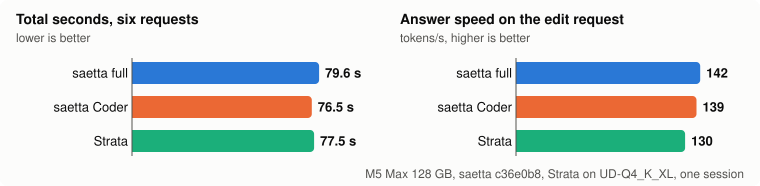

<p align="center">
  
</p>

<h3 align="center">Local coding models for Apple Silicon Macs.</h3>
<p align="center">Qwen3.8-27B from 32 GB of memory, Qwen3.8-Flash-Next from 96 GB. An inference engine in C and hand-written Metal, tuned for coding agents.</p>

<p align="center">
  <a href="#install"><b>Install</b></a> · <a href="#models">Models</a> · <a href="#coding-agents">Coding agents</a> ·
  <a href="#server">Server</a> · <a href="#performance">Performance</a> · <a href="#build-from-source">Build from source</a>
</p>

<p align="center">
  <a href="https://github.com/antonellof/saetta/releases/latest"></a>
  <a href="LICENSE"></a>
  
</p>

saetta runs Qwen3.8 coding models on any Apple Silicon Mac with 32 GB of memory or more, with every kernel written for coding agents: long shared-prefix prompts (20K to 200K tokens), short answers, tool calls, through OpenAI- and Anthropic-compatible APIs. It picks the model that fits your Mac. It is tuned and measured on an M5 Max with 128 GB, whose neural accelerators read prompts fastest; M1 to M4 run the same kernels on their GPU cores (not yet tested on those chips: reports welcome).

- **Fast:** on an M5 Max, Flash-Next reads prompts at 1,600 to 1,950 tokens/s and answers at 66 to 85 tokens/s, with speculative decoding.
- **On par with [Strata](https://github.com/Niko1221/Strata)**, the established engine for Flash-Next on Apple Silicon: the Coder pack finishes the six-request agent workload 1 s ahead, the full pack 2 s behind, and both answer faster ([Performance](#performance)).
- **Follow-up turns read only what is new:** a second turn on a 16K conversation answers in 0.2 s.
- **One command to code:** `saetta start claude` (or `pi`, `opencode`).
- **LoRA adapters** on Qwen3.8-27B, per request.
- **Checked** layer by layer against numpy references; one binary, no Python.

## Install

```sh
curl -fsSL https://github.com/antonellof/saetta/releases/latest/download/install.sh | sh   # into ~/.local/bin
saetta download          # the model that fits this Mac, into ~/Models, resumable, hash-checked
saetta start claude      # or: saetta start pi, saetta start opencode
```

`saetta download` picks by memory: `coder` (Flash-Next, 76 GB) with 96 GB or more, `27b-turbo` (Qwen3.8-27B fine-tune, 20 GB, converted from its GGUF: about 40 GB free disk while it runs) with 36 GB, `27b-4bit` (16 GB) with 32 GB. Any pack can be named instead (table below); one that cannot run on this Mac is refused, and the context shrinks to what memory holds.

Needs an Apple Silicon Mac (M1 or later) with 32 GB of memory or more, and macOS 27.2 or later. Update with `saetta update`. `SAETTA_PREFIX` changes the install folder, `SAETTA_VERSION=0.12.0` pins a release, `HF_TOKEN` raises Hugging Face's limits.

## Models

`saetta download <name>` fetches a pack at a pinned revision into `~/Models` (or `SAETTA_MODELS`). Commands take a pack by name (`saetta serve coder`) or folder.

| name | model | on disk | Mac memory |
|---|---|---|---|
| **`coder`** · for agents | [Flash-Next](https://huggingface.co/mbrown-uno/Qwen3.8-Flash-Next-GSQ-RCO-Coder-MLX), 256 experts pruned for code, mixed 4/5/6/8-bit | 76 GB | 96 GB |
| `full` | [Flash-Next](https://huggingface.co/mlx-community/Qwen3.8-Flash-Next-4bit-mtp), all 512 experts, 4-bit | 105 GB | 128 GB |
| `27b-8bit` · with adapters | [Qwen3.8-27B](https://huggingface.co/mlx-community/Qwen3.8-27B-8bit), dense, 8-bit | 29 GB | 48 GB |
| `27b-4bit` | [Qwen3.8-27B](https://huggingface.co/mlx-community/Qwen3.8-27B-4bit), dense, 4-bit | 16 GB | 32 GB |
| `27b-pi` | [the pi LoRA adapter](https://huggingface.co/harness-hub/Qwen3.8-27B-pi-adapted) for Qwen3.8-27B | 0.6 GB | |
| **`27b-turbo`** · with MTP | [TURBO Fable Cold Fusion](https://huggingface.co/DavidAU/Qwen3.8-27B-TURBO-Fable-Cold-Fusion-735-882-Heretic-Uncensored-NEO-CODER-MAX-MTP-GGUF), a Qwen3.8-27B fine-tune with shorter thinking, from its Q4_K_M GGUF | 20 GB | 36 GB |
| `27b-turbo-8bit` · with MTP | the same, from its Q8_0 GGUF | 30 GB | 48 GB |

With less memory the context is smaller: about 37K tokens with `27b-4bit` on 32 GB. `SAETTA_IGNORE_MEMORY=1` skips the memory checks.

Licenses: Flash-Next Qwen Community License 1.0, Qwen3.8-27B, the pi adapter and TURBO Apache-2.0; no weights are part of this repository.

### GGUF fine-tunes of Qwen3.8-27B

`saetta download 27b-turbo` fetches the GGUF, converts it into a saetta pack and deletes it. `saetta import <file.gguf> <folder>` does the same for any Qwen3.8-27B GGUF (llama.cpp `qwen35`; Q8_0, Q4_K, Q5_K, Q6_K, F16 or BF16 tensors), with the model's `config.json` and tokenizer files in the folder. A GGUF's MTP layer becomes the draft head: Qwen3.8-27B speculates with it as Flash-Next does (`SAETTA_MTP=0` turns it off).

### LoRA adapters

PEFT LoRA adapters run on Qwen3.8-27B at run time, with vLLM's flags. The [pi adapter](https://huggingface.co/harness-hub/Qwen3.8-27B-pi-adapted) is trained to drive the [pi](https://pi.dev) agent (its card: SWE-bench Pro hard 39.2% to 64.7% over the base model).

```sh
saetta download 27b-8bit && saetta download 27b-pi
saetta start pi --pack 27b-8bit --lora qwen3.8-pi=27b-pi                    # pi on it
saetta serve 27b-8bit --lora-modules qwen3.8-pi=27b-pi \
    --default-chat-template-kwargs '{"enable_thinking": false}'            # or any client
```

A request whose `model` is the adapter's name runs with it, any other with the base model. Supported: LoRA on attention and MLP projections, rank a multiple of 8 up to 128, rsLoRA. `SAETTA_LORA=<folder>` applies one to `saetta generate`.

## Coding agents

```sh
saetta start claude      # Claude Code
saetta start pi          # pi
saetta start opencode    # opencode
saetta start claude -- -p "fix the failing test"   # anything after -- goes to the agent
```

<p align="center">
  
  <br><sub><code>saetta start claude</code>: Claude Code on the local model writes a snake game and checks it. Real time, no cloud.</sub>
</p>

`saetta start` joins the server on this machine or starts one, waits for the model and runs the agent pointed at it, without touching your agent configuration; the server it started stops with the last session. Several sessions share one server (up to 4 conversations, `SAETTA_CONVERSATIONS`).

| option | effect |
|---|---|
| `--pack <name or dir>` | the model (default: the first downloaded pack that fits this Mac: coder, full, then the 27B packs) |
| `--lora name=adapter` | a LoRA adapter on a 27B pack |
| `--port N`, `--ctx N` | server port (8080) and context (204800 tokens) |
| `--keep` | leave the server running when the agent exits |

<p align="center">
  
  <br><sub><code>saetta start pi</code>: pi writes a Mandelbrot renderer, then it runs.</sub>
</p>

Without `saetta start`, point any agent at `http://127.0.0.1:8080/v1` (OpenAI) or `http://127.0.0.1:8080` (Anthropic), any API key: configs in [`config/`](config) ([Claude Code](docs/claude-code.md), [opencode](docs/opencode.md)).

## Server

```sh
SAETTA_CTX=204800 saetta serve coder     # loads in 5 to 10 s, one request at a time, Ctrl-C stops
saetta monitor | status | stop           # live view, state, stop
```

Endpoints: `POST /v1/chat/completions` (streaming, `tool_calls`, `reasoning_content`; `enable_thinking`, `reasoning_effort` in `chat_template_kwargs`), `POST /v1/messages` and `/v1/messages/count_tokens` (Anthropic), `GET /v1/models`, `GET /health`. Model ids: `qwen3.8-flash-next`, `qwen3.8-27b`.

| variable | default | effect |
|---|---|---|
| `SAETTA_CTX` | 32768 | context in tokens, 1024 to 262144, rounded down to a multiple of 128 (Flash-Next about 35 KB per token, 27B 64 KB) |
| `SAETTA_SPEC` / `SAETTA_MTP` | 1 / 1 | `0` turns speculative decoding / the MTP head off |
| `SAETTA_KV_F32` | unset | f32 KV cache |
| `SAETTA_IGNORE_MEMORY` | unset | `1` loads or downloads a pack this Mac's memory is too small for, and keeps the asked context |
| `SAETTA_NO_ACCEL` | unset | `1` runs without the tensor-op (neural accelerator) kernels, for a Mac where they misbehave (slower prompt reading, same output) |
| `SAETTA_EXPERT_CACHE_GB` | unset | experimental: keep this many GB of experts in memory, read the rest from the SSD (Flash-Next: slower than resident, same output) |

<p align="center">
  
</p>

## Performance

<p align="center">
  
</p>

Flash-Next on an M5 Max with 128 GB, a six-request coding-agent workload, seconds (first token / total):

| request | prompt tokens | full | Coder | Strata (UD-Q4_K_XL) |
|---|---:|---:|---:|---:|
| cold 4K | 3,335 | 2.06 / 3.66 | 2.01 / 3.90 | 1.90 / 3.24 |
| cold 16K | 15,873 | 8.78 / 10.61 | 8.24 / 10.86 | 8.82 / 10.34 |
| cold 64K | 69,923 | 40.23 / 42.16 | 37.31 / 39.87 | 39.57 / 41.53 |
| turn 1 | 15,867 | 8.68 / 9.39 | 8.07 / 8.81 | 8.96 / 9.61 |
| turn 2 (reuses turn 1) | 15,951 | 0.20 / 0.87 | 0.20 / 0.79 | 0.19 / 0.56 |
| edit (tool call, 400 tokens out) | 18,243 | 10.09 / 12.91 | 9.37 / 12.25 | 10.14 / 13.19 |
| sum of totals | | 79.6 | 76.5 | 77.5 |

Answers at 78 to 85 (full) and 66 to 75 (Coder) tokens/s, 142 tokens/s on the edit with speculation (Strata 130). Answer lengths differ between engines (cold 4K: 130 tokens against Strata's 102), which accounts for most of the gap on the short requests. Qwen3.8-27B: prompts at 940 tokens/s (4K) to 787 (64K); answers at 31 ms/token on the 4-bit pack, 19 ms/token on `27b-turbo` with its MTP head (short prompts; 25 ms/token at 16K).

## Build from source

Needs full Xcode with the Metal Toolchain (`xcodebuild -downloadComponent MetalToolchain`) and Apple clang 21 or later (C23).

```sh
git clone https://github.com/antonellof/saetta.git && cd saetta
make                                    # ./build/bin/saetta
make test                               # unit tests (SAETTA_PACK=<pack> for real tensors)
make verify GOLDEN=<dir>/golden         # development: against reference outputs (not in this repository)
```

`src/`: `model.c` (Flash-Next), `dense.c` (27B), `model_api.c` picks one per pack; `kernels/` Metal; `server.c`, `tokenizer.c`, `chat.c`, `toolcall.c`. `saetta help` lists every command.

## License

[MIT](LICENSE). Parts are adapted from the MIT-licensed projects sushi, qwental, Strata, ds4 and llama.cpp; each adapted file names its source, and their notices are in [LICENSE](LICENSE).
