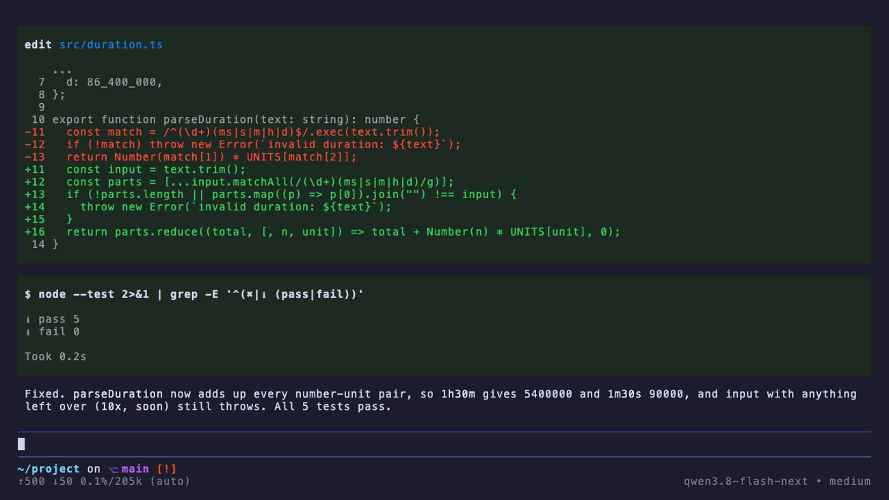
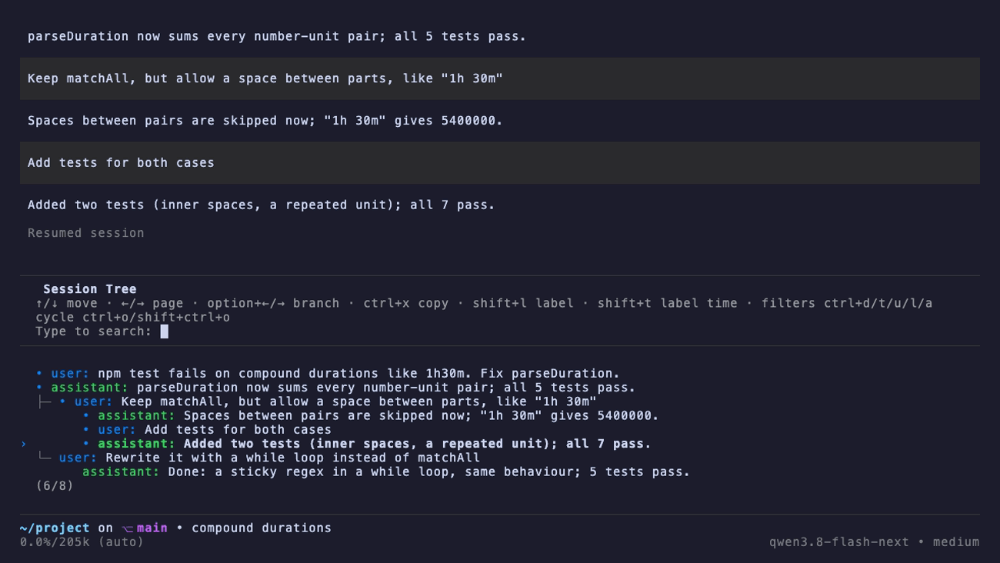
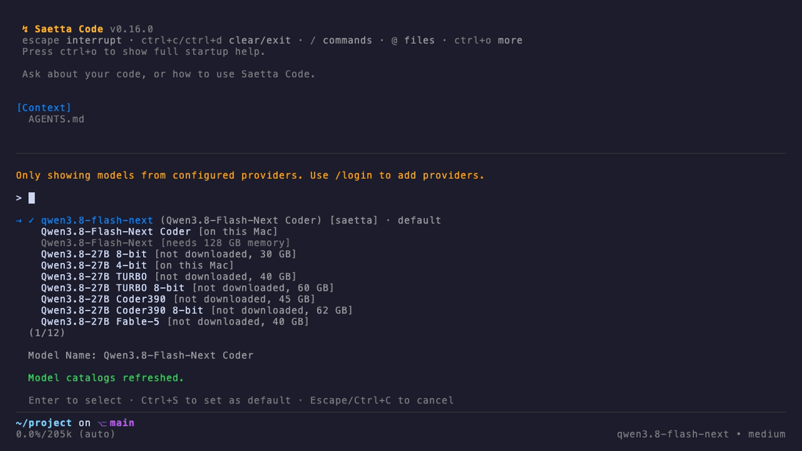
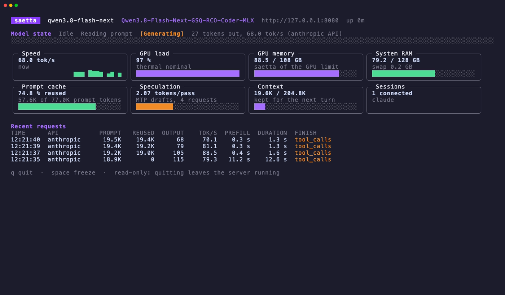

<p align="center">
  
</p>

<h3 align="center">Saetta: a local coding agent with built-in inference.</h3>
<p align="center">A coding agent for Apple Silicon Macs with the model inside it: a C port of pi that runs Qwen3.8 and Inkling 2 Mini in its own process, on its own Metal inference engine, without Python, Node or a server. <a href="https://saetta.dev">saetta.dev</a></p>

<p align="center">
  <a href="#start"><b>Start</b></a> · <a href="#models"><b>Models</b></a> · <a href="#what-the-agent-does"><b>The agent</b></a> ·
  <a href="#other-agents-and-clients">Other agents</a> · <a href="#performance">Performance</a> · <a href="#build-from-source">Build from source</a>
</p>

<p align="center">
  <a href="https://saetta.dev"></a>
  <a href="https://github.com/antonellof/saetta/releases/latest"></a>
  <a href="LICENSE"></a>
  
</p>

Saetta Code is the agent inside the `saetta` binary, a 2.3 MB program. It has pi's tools, sessions, skills, MCP servers and terminal UI, and the model runs in the same process, so nothing goes over HTTP between the two. The engine is written in C and hand-written Metal for agent work: long prompts that share a prefix (20K to 200K tokens), short answers and tool calls. It runs on any Apple Silicon Mac with 32 GB of memory or more and picks the model that fits.

<p align="center">
  
  <br><sub><code>saetta start code</code> loads the model, writes a landing page for a coffee roastery in one HTML file, checks it and fixes what it finds; then the page as a browser shows it. The typing, the thinking and the waits are cut, the checks play at 8x.</sub>
</p>

## Start

```sh
curl -fsSL https://saetta.dev/install.sh | sh    # into ~/.local/bin
cd ~/src/my-project
saetta start code
```

On the first run `saetta start code` shows the model that fits this Mac, downloads it after you confirm (resumable, hash-checked, into `~/Models`) and opens the agent on it. By memory it picks `coder` (Qwen3.8-Flash-Next, 76 GB) with 96 GB or more, `27b-turbo` (a Qwen3.8-27B fine-tune, 20 GB, converted from its GGUF: about 40 GB free disk while it runs) with 36 GB, and `27b-4bit` (16 GB) with 32 GB.

To run another model, download its pack and name it:

```sh
saetta download inkling                 # Inkling 2 Mini, 17 GB, from 32 GB of memory
saetta download inkling-dspark          # its DSpark drafter, 0.6 GB (optional; used with SAETTA_DSPARK=1)
saetta start code --pack inkling
saetta download 27b-qwopus              # Qwopus, a Qwen3.8-27B coding fine-tune, 16 GB
saetta start code --pack 27b-qwopus
```

Inside the agent, `/model` lists the packs on this Mac and the ones you can download (with their size, the free disk, and the ones too big for this Mac greyed out), downloads the one you pick and switches to it without leaving the session.

`saetta` alone is a guided start: it shows the chip, memory and free disk, lists the models best first, downloads the one you pick and starts Saetta Code or one of the other agents it finds on this Mac.

Needs an Apple Silicon Mac (M1 or later) with 32 GB of memory or more, and macOS 26 or later. Update with `saetta update`. `SAETTA_PREFIX` changes the install folder, `SAETTA_VERSION=0.17.1` pins a release, `HF_TOKEN` raises Hugging Face's limits. The documentation is at [saetta.dev/docs](https://saetta.dev/docs/) (source in [`docs/`](docs)).

## Models

### Model families

| family | Mac memory | good for | packs | published scores |
|---|---|---|---|---|
| **Qwen3.8-Flash-Next** | 96 GB (`coder`), 128 GB (`full`) | the fastest here and the highest published scores; `coder` keeps the 256 of 512 experts that matter for code | `coder`, `full` | SWE-bench Verified 82.8 (full), 79.2 (Coder) |
| **Qwen3.8-27B** | 32 GB (4-bit), 48 GB (8-bit) | dense, fits a 32 GB Mac; LoRA adapters on the 8-bit pack; coding fine-tunes with a draft head that answers faster | `27b-4bit`, `27b-8bit`, fine-tunes | SWE-bench Pro 61.7, Terminal-Bench 2.1 73.0 |
| **Inkling 2 Mini** | 32 GB | Thinking Machines' 26B mixture of experts, 3.4B active per token; context up to 1M tokens where memory allows | `inkling` | SWE-bench Verified 79.2, Terminal-Bench 2.1 71.6 |

The scores are the publishers', for the full-precision models, each with its own harness; Saetta has not measured them on these packs (sources below).

### All packs

`saetta download <name>` fetches a pack at a pinned revision into `~/Models` (or `SAETTA_MODELS`); `--pack <name>` and `/model` take the same names.

| name | weights | on disk | Mac memory | options | SWE-bench | Terminal-Bench 2.1 |
|---|---|---|---|---|---|---|
| **Qwen3.8-Flash-Next** | | | | | | |
| **`coder`** | [Flash-Next Coder](https://huggingface.co/mbrown-uno/Qwen3.8-Flash-Next-GSQ-RCO-Coder-MLX), 256 experts, mixed 4/5/6/8-bit | 76 GB | 96 GB | draft head (MTP) | Verified 79.2 ¹ | n/p |
| `full` | [Flash-Next](https://huggingface.co/mlx-community/Qwen3.8-Flash-Next-4bit-mtp), 512 experts, 4-bit | 105 GB | 128 GB | draft head (MTP) | Pro 62.5 ², Verified 82.8 ¹ | n/p |
| **Qwen3.8-27B** | | | | | | |
| **`27b-4bit`** | [Qwen3.8-27B](https://huggingface.co/mlx-community/Qwen3.8-27B-4bit), 4-bit | 16 GB | 32 GB | | Pro 61.7 ² | 73.0 ² |
| `27b-8bit` | [Qwen3.8-27B](https://huggingface.co/mlx-community/Qwen3.8-27B-8bit), 8-bit | 29 GB | 48 GB | LoRA adapters | Pro 61.7 ² | 73.0 ² |
| `27b-pi` | [pi adapter](https://huggingface.co/harness-hub/Qwen3.8-27B-pi-adapted) (LoRA, for `27b-8bit`) | 0.6 GB | | trained to drive pi | Pro hard-51 64.7 ³ | 55.8 ³ |
| **`27b-turbo`** | [TURBO Fable Cold Fusion](https://huggingface.co/DavidAU/Qwen3.8-27B-TURBO-Fable-Cold-Fusion-735-882-Heretic-Uncensored-NEO-CODER-MAX-MTP-GGUF), shorter thinking, from Q4_K_M | 20 GB | 36 GB | draft head (MTP) | n/p | n/p |
| `27b-turbo-8bit` | the same, from Q8_0 | 30 GB | 48 GB | draft head (MTP) | n/p | n/p |
| `27b-coder390` | [Coder390 EfficientThink](https://huggingface.co/nerkyor/Qwen3.8-27B-Coder390-EfficientThink-Opus5.5-GPT6Astra-Grok4.7-DSV4Pro-K3-SFT-RLOO-GGUF-NInfer), SFT and RL on code, from Q4 | 23 GB | 48 GB | draft head (MTP) | n/p | n/p |
| `27b-coder390-8bit` | the same, from Q8_0 | 31 GB | 48 GB | draft head (MTP) | n/p | n/p |
| `27b-fable5` | [Fable-5 Coding Distilled](https://huggingface.co/khazarai/Qwen3.8-27B-Fable-5-Coding-Distilled), from [imatrix Q4_K_M](https://huggingface.co/mradermacher/Qwen3.8-27B-Fable-5-Coding-Distilled-i1-GGUF) | 20 GB | 36 GB | draft head (MTP) | n/p | n/p |
| `27b-fable5-8bit` | the same, from Q8_0 | 31 GB | 48 GB | draft head (MTP) | n/p | n/p |
| `27b-qwopus` | [Qwopus3.8-27B Coder-Flash](https://huggingface.co/mlx-community/Qwopus3.8-27B-Coder-Flash-4bit), distilled from Qwen3.8-Flash-Max, 4-bit | 16 GB | 32 GB | | n/p ⁵ | n/p ⁵ |
| `27b-qwopus-8bit` | [the same](https://huggingface.co/mlx-community/Qwopus3.8-27B-Coder-Flash-8bit), 8-bit | 29 GB | 48 GB | | n/p ⁵ | n/p ⁵ |
| **Inkling 2 Mini** | | | | | | |
| `inkling` | [Inkling 2 Mini](https://huggingface.co/mlx-community/Inkling-2-Mini-4bit), dense 4-bit, experts NVFP4 / MXFP8 | 17 GB | 32 GB | prompt lookup; 1M context | Verified 79.2 ⁴ | 71.6 ⁴ |
| `inkling-dspark` | [DSpark drafter](https://huggingface.co/thinkingmachines/Inkling-2-Mini) for `inkling` | 0.6 GB | | opt-in, `SAETTA_DSPARK=1` | | |

The GGUF fine-tunes are converted into packs on download (about 40 GB of free disk while it runs). In **bold**: what `saetta download` picks by memory.

SWE-bench and Terminal-Bench are the publishers' scores for the full-precision model, each with its own harness, not measured by Saetta on these packs: ¹ [ISTA-DASLab](https://huggingface.co/ISTA-DASLab/Qwen3.8-Flash-Next-GSQ-RCO-Coder-GGUF) (SWE-bench Verified, xhigh reasoning; the Coder against the full model), ² [Qwen](https://huggingface.co/Qwen/Qwen3.8-27B) ([Flash-Next](https://huggingface.co/Qwen/Qwen3.8-Flash-Next); SWE-bench Pro with Claude Code, Terminal-Bench 2.1 with Terminus), ³ [harness-hub](https://huggingface.co/harness-hub/Qwen3.8-27B-pi-adapted) (the adapter under pi, SWE-bench Pro's hard 51 tasks; the base model scores 39.2 and 39.5 there). ⁴ [Thinking Machines](https://huggingface.co/thinkingmachines/Inkling-2-Mini) (SWE-bench Verified with bash only, Terminal-Bench 2.1 with pi). ⁵ [Jackrong](https://huggingface.co/Jackrong/Qwopus3.8-27B-Coder-Flash) publishes only its own local tests (an MMLU-Pro subset of 1,500 questions, 93.87; 9 of 9 runs of a 3-task coding-agent test). n/p: not published (Qwen publishes no Terminal-Bench score for Flash-Next; the fine-tunes publish none for either).

A pack that cannot run on this Mac is refused, and the context shrinks to what memory holds: about 37K tokens with `27b-4bit` on 32 GB. `SAETTA_IGNORE_MEMORY=1` skips the memory checks. Every model is checked layer by layer against a numpy reference built from the same weights.

### Inkling 2 Mini

[Inkling 2 Mini](https://huggingface.co/thinkingmachines/Inkling-2-Mini) is Thinking Machines' coding model: 26B parameters in a mixture of 128 experts, 8 used per token. Its 24 layers run as 48 (a block of 12 is looped three times), with sliding-window attention and its own JSON tool-call format, which Saetta translates for the agent and for the OpenAI and Anthropic APIs. The MLX pack keeps Thinking Machines' NVFP4 and MXFP8 experts as published. Its context goes to 1,048,576 tokens (32 KB per token in the f16 cache, 36 KB with the drafter), as far as memory allows. Saetta speeds up Inkling's answers with prompt lookup by default (on an M5 Max at a 4K prompt: 58.6 tokens/s without it, 85.3 with it). Thinking Machines' DSpark block drafter is opt-in: `saetta download inkling-dspark`, then start with `SAETTA_DSPARK=1`. Drafts are checked in one pass of the model, so greedy output is token for token the same as without them and sampled output follows the same distribution; at 4K, lookup with the drafter measured 79 tokens/s, below lookup alone, so it stays off until its verify pass gets cheaper. `/model` in Saetta Code shows whether the drafter is downloaded and downloads it. This is a first version: prompts on the GPU cores rather than the M5's neural accelerators, and a follow-up turn reuses the conversation only when it appends to it.

### GGUF fine-tunes of Qwen3.8-27B

`saetta download 27b-turbo` (or `27b-coder390`, `27b-fable5`) fetches the GGUF, converts it into a Saetta pack and deletes it. `saetta import <file.gguf> <folder>` does the same for any Qwen3.8-27B GGUF (llama.cpp `qwen35`; Q8_0, Q4_K, Q5_K, Q6_K, F16 or BF16 tensors), with the model's `config.json` and tokenizer files in the folder. A GGUF's MTP layer becomes the draft head: Qwen3.8-27B speculates with it as Flash-Next does (`SAETTA_MTP=0` turns it off).

### LoRA adapters

PEFT LoRA adapters run on Qwen3.8-27B at run time, with vLLM's flags, in the agent's own process. The [pi adapter](https://huggingface.co/harness-hub/Qwen3.8-27B-pi-adapted) is trained to drive the [pi](https://pi.dev) agent, whose tools and prompt Saetta Code shares (its card: SWE-bench Pro hard 39.2% to 64.7% over the base model).

```sh
saetta download 27b-8bit && saetta download 27b-pi
saetta start code --pack 27b-8bit --lora-modules qwen3.8-pi=27b-pi
```

The session runs on the first adapter (`--model NAME` picks another, or the base model). `/model` lists the downloaded adapters under each base model they fit, downloads the others and switches between them. An adapter that does not fit the base model (its base, rank or target modules) is refused with the reason. Supported: LoRA on attention and MLP projections, rank a multiple of 8 up to 128, rsLoRA. See [LoRA adapters](docs/lora.md).

Licenses: Flash-Next Qwen Community License 1.0; Qwen3.8-27B, the pi adapter, TURBO, Coder390, Fable-5, Qwopus and Inkling 2 Mini Apache-2.0. No weights are part of this repository.

## What the agent does

Saetta Code is a port of the [pi](https://pi.dev) coding agent 1.5.2 (MIT). It has pi's tools (read, bash, edit, write; grep, find and ls with `--tools`), its system prompt, `AGENTS.md` and `CLAUDE.md` context files, skills (and `/skill:name`), prompt files and session files. It reads and writes pi's `settings.json`, `models.json`, `trust.json` and `mcp.json` in `~/.pi/agent`, so the two share one setup, and each continues the other's sessions, compacted ones included.

Its requests and session files match pi's byte for byte on 63 recorded print and JSON scenarios (tool errors, edits, truncation, sessions, compaction, retries, skills), apart from its own system prompt preamble. Its interactive screens are compared with pi's on 75 recorded scenarios, and its rpc mode with pi's, driven by pi's own rpc client, on 12. pi's TypeScript extensions and packages are not supported, and there is no image input.

```sh
saetta start code                       # the model inside the agent
saetta code --pack coder                # the same with a chosen pack; Escape stops a turn
saetta code -c                          # continue this folder's last session (pi's too)
saetta code -p "fix the failing test"   # print mode, as pi -p
saetta code --mode json -p "..."        # pi's JSON event stream
saetta code --mode rpc                  # pi's rpc protocol: JSON commands on stdin, events on stdout
saetta code --subagents                 # a subagent tool: up to 3 child agents at once
```

### The terminal UI

The interactive view is pi's terminal UI ported to C: differential rendering, an editor with "/" commands and "@" file completion, markdown with highlighted code, tool views with word diffs for edits, bash output shown as it runs, and the model, settings, thinking and session tree selectors. While the agent works, Enter queues a message that steers the current turn and Option+Enter a follow-up for after it. Saetta adds a default theme with macOS's colors (`/theme` switches to pi's themes, with a live preview), a footer like a starship prompt (the folder as `~/...`, the git branch and status, the time of the last turn, the last turn's generation speed in tok/s, the model's full name and quantization), and a 3D lightning loader drawn inline while the model loads. The agent checks for a new release at start.

<p align="center"></p>

### Commands

| command | what it does |
|---|---|
| `/model` | switch between downloaded packs and LoRA adapters in process (adapters listed under their base model), download a pack or an adapter from the list (its size and the free disk shown first), add or edit OpenAI-compatible models |
| `/monitor` | the engine's live stats inside the agent: speed, GPU, memory, prompt-cache reuse, speculation, recent requests |
| `/compact`, `/resume`, `/new` | compact the context, open another session, start a new one |
| `/fork`, `/clone`, `/tree` | branch from an earlier message, duplicate the session, move through its tree |
| `/name`, `/session` | name the session, show its info and stats |
| `/export`, `/import`, `/share`, `/copy` | the session as HTML or JSONL, a JSONL session back in, a secret GitHub gist, the last answer to the clipboard |
| `/settings`, `/theme`, `/thinking`, `/scoped-models`, `/hotkeys` | settings, theme, thinking level, the models Ctrl+P cycles through, keyboard shortcuts |
| `/trust`, `/reload`, `/mcp`, `/changelog` | project trust, reload skills, prompts and context files, MCP servers, release notes |

<p align="center"></p>

### MCP

MCP servers come from pi's `mcp.json` (global, or `.pi/mcp.json` in a trusted project), over stdio or Streamable HTTP, with OAuth sign-in for HTTP servers as pi does it. Their tools are offered to the model as `mcp__server__tool`, along with tools to read the servers' resources. `/mcp` reconnects, enables or disables a server and changes its exposure; `--no-mcp` turns them all off.

### Parallel agents

Several Saetta Code sessions share one model: a `saetta start code` in another terminal uses the model the first one loaded, each session in its own conversation. `--subagents` (or `"subagents": true` in `settings.json`) gives the model a tool that hands self-contained tasks to child agents, up to 3 at once; it is off by default, which keeps the prompt pi's. See [Parallel agents](docs/parallel-agents.md).

### Other models

By default the model runs inside the agent. Saetta Code can also use a running Saetta server, or any OpenAI-compatible chat completions server listed in `models.json`; `/model` adds one.

In process, the engine's state of the conversation (its KV cache and recurrent state) is saved to `~/.saetta/state` in the background at the end of each turn, so a session reopened later (`--session`, `--continue`, `/resume`) or forked from an earlier message (`/fork`) continues from it instead of reading its whole history again. The folder keeps up to 20 GB and nothing unused for 7 days; `SAETTA_STATE=0` turns it off. Not yet for Inkling 2 Mini or with a LoRA adapter. In memory, the engine keeps checkpoints at message starts, so a retried turn, an edited message or a `/fork` restarts at the nearest message, also over the HTTP API ([sessions](docs/sessions.md)). Next: prompts read while tools run.

<p align="center"></p>

A run cut off by a crash, a kill or a closed terminal is resumed at the next start: finished tool calls keep their result, read-only ones run again, and a command or edit that was running is never run again without asking. See [Interrupted runs](docs/sessions.md#interrupted-runs).

Coming next: prompts read while tools run; a cheaper DSpark verify pass and the M5's neural accelerators for Inkling 2 Mini; the agent's commands confined to the project by macOS's Seatbelt.

## Other agents and clients

The engine inside Saetta Code also runs as a local server with OpenAI- and Anthropic-compatible APIs, and `saetta start` points Claude Code, pi or opencode at it:

```sh
saetta start claude      # Claude Code
saetta start pi          # pi
saetta start opencode    # opencode
saetta start claude -- -p "fix the failing test"   # anything after -- goes to the agent
```

<p align="center">
  
  <br><sub><code>saetta start claude</code>: Claude Code on the local model writes a snake game and checks it. Real time, no cloud.</sub>
</p>

`saetta start` joins the server on this machine or starts one, waits for the model and runs the agent pointed at it, without touching your agent configuration; the server it started stops with the last session. Several sessions share one server (up to 4 conversations, `SAETTA_CONVERSATIONS`).

| option | effect |
|---|---|
| `<pack>`, `--pack <name or dir>` | the model (default: the first downloaded pack that fits this Mac: coder, full, then the 27B packs) |
| `--lora-modules name=adapter ...` | LoRA adapters on a 27B pack, as `saetta serve` takes them (`--lora name=adapter` for one) |
| `--default-chat-template-kwargs JSON` | chat template values a request leaves out (with adapters: thinking off unless given) |
| `--port N`, `--ctx N` | server port (8080) and context (204800 tokens) |
| `--keep` | leave the server running when the agent exits |

<p align="center">
  
  <br><sub><code>saetta start pi</code>: pi writes a Mandelbrot renderer, then it runs.</sub>
</p>

Without `saetta start`, point any agent at `http://127.0.0.1:8080/v1` (OpenAI) or `http://127.0.0.1:8080` (Anthropic), any API key: configs in [`config/`](config) ([Claude Code](docs/claude-code.md), [opencode](docs/opencode.md)).

### Server

```sh
SAETTA_CTX=204800 saetta serve coder     # loads in 5 to 10 s, one request at a time, Ctrl-C stops
saetta serve 27b-8bit --lora-modules qwen3.8-pi=27b-pi \
    --default-chat-template-kwargs '{"enable_thinking": false}'   # a request whose model is the adapter's name runs with it
saetta monitor | status | stop           # live view, state, stop
```

Endpoints: `POST /v1/chat/completions` (streaming, `tool_calls`, `reasoning_content`; `enable_thinking`, `reasoning_effort` in `chat_template_kwargs`), `POST /v1/messages` and `/v1/messages/count_tokens` (Anthropic), `GET /v1/models`, `GET /health`. Model ids: `qwen3.8-flash-next`, `qwen3.8-27b`, `inkling-2-mini`.

| variable | default | effect |
|---|---|---|
| `SAETTA_CTX` | 32768 | context in tokens, 1024 to 262144 (Inkling 2 Mini 1048576), rounded down to a multiple of 128 (Flash-Next about 35 KB per token, 27B 64 KB, Inkling 32 KB) |
| `SAETTA_SPEC` / `SAETTA_MTP` | 1 / 1 | `0` turns speculative decoding / the MTP head (Inkling: the DSpark drafter) off |
| `SAETTA_DSPARK` | unset | Inkling 2 Mini: `1` loads the downloaded DSpark drafter (or a path to its `mtp.safetensors`); off by default |
| `SAETTA_KV_F32` | unset | f32 KV cache |
| `SAETTA_IGNORE_MEMORY` | unset | `1` loads or downloads a pack this Mac's memory is too small for, and keeps the asked context |
| `SAETTA_NO_ACCEL` | unset | `1` runs without the tensor-op (neural accelerator) kernels on an M5 (M1 to M4 never use them; `SAETTA_ACCEL=1` forces them there, for testing) |
| `SAETTA_EXPERT_CACHE_GB` | unset | experimental: keep this many GB of experts in memory, read the rest from the SSD (Flash-Next: slower than resident, same output) |

`saetta monitor` shows the server live: model state, speed, GPU load, memory, prompt cache, speculation, sessions and recent requests. `/monitor` shows the same view inside Saetta Code.

<p align="center">
  
</p>

## Performance

Tuned and measured on an M5 Max with 128 GB, whose neural accelerators read prompts fastest. M1 to M4 read prompts with half-precision kernels of their own on their GPU cores and are not measured yet (reports welcome).

Flash-Next on the M5 Max, a six-request coding-agent workload through the HTTP API, seconds (first token / total):

| request | prompt tokens | full | Coder |
|---|---:|---:|---:|
| cold 4K | 3,335 | 2.06 / 3.66 | 2.01 / 3.90 |
| cold 16K | 15,873 | 8.78 / 10.61 | 8.24 / 10.86 |
| cold 64K | 69,923 | 40.23 / 42.16 | 37.31 / 39.87 |
| turn 1 | 15,867 | 8.68 / 9.39 | 8.07 / 8.81 |
| turn 2 (reuses turn 1) | 15,951 | 0.20 / 0.87 | 0.20 / 0.79 |
| edit (tool call, 400 tokens out) | 18,243 | 10.09 / 12.91 | 9.37 / 12.25 |
| sum of totals | | 79.6 | 76.5 |

Prompts at 1,620 to 1,930 tokens/s; answers at 78 to 85 (full) and 66 to 75 (Coder) tokens/s, 142 and 139 tokens/s on the edit with speculation. A follow-up turn reads only what is new: turn 2 above answers in 0.2 s. Qwen3.8-27B: prompts at 940 tokens/s (4K) to 787 (64K); answers at 31 ms/token on the 4-bit pack, 19 ms/token on `27b-turbo` with its MTP head (short prompts; 25 ms/token at 16K).

Inkling 2 Mini, 4K prompt: 470 tokens/s reading, 58 tokens/s answering without speculation. 32K prompt: 419 tokens/s reading, 52 tokens/s answering without speculation.

On the M5 Max forced onto the M1 to M4 prompt kernels, the 27B reads a 4K prompt at 256 tokens/s and the Coder at 742, against 961 and 1,538 with the neural accelerators on the same prompt.

## Build from source

Needs full Xcode with the Metal Toolchain (`xcodebuild -downloadComponent MetalToolchain`) and Apple clang 21 or later (C23).

```sh
git clone https://github.com/antonellof/saetta.git && cd saetta
make                                    # ./build/bin/saetta
make test                               # unit tests (SAETTA_PACK=<pack> for real tensors)
make verify GOLDEN=<dir>/golden         # development: against reference outputs (not in this repository)
```

`src/`: `code*.c` Saetta Code; `model.c` (Flash-Next), `dense.c` (27B), `inkling.c` (Inkling 2 Mini), `model_api.c` picks one per pack; `kernels/` Metal; `server.c`, `tokenizer.c`, `chat.c`, `toolcall.c`. `saetta help` lists every command.

## License

[MIT](LICENSE). The engine adapts parts of the MIT-licensed projects sushi, qwental, Strata, ds4, llama.cpp and MLX. Saetta Code is a port of pi (MIT) and adapts parts of the libraries pi builds on (jsdiff, TypeBox, openai-node, highlight.js, marked, OpenTUI). Each adapted file names its source, and every notice is in [LICENSE](LICENSE).
