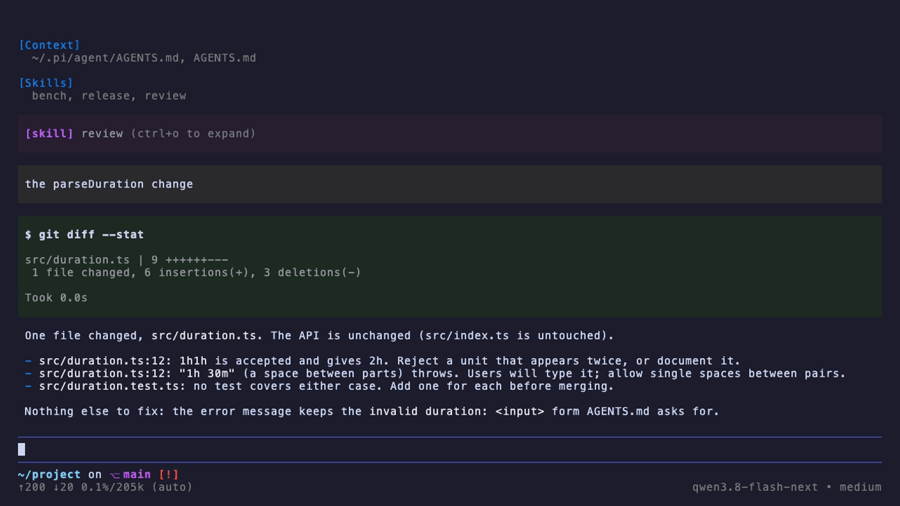

# Context and skills

Saetta Code builds its system prompt as pi does: pi's base prompt with the tool descriptions, then the context files, then the skills, with your own additions where you put them.

## Context files

At the start of a session the agent loads:

1. The agent folder's own `AGENTS.md` (global instructions for every project).
2. One file per directory from the filesystem root down to the working directory: the first of `AGENTS.override.md`, `AGENTS.md`, `AGENTS.MD`, `CLAUDE.md`, `CLAUDE.MD` found there.

A repository's existing `CLAUDE.md` is picked up as it is. In a git worktree nested inside its main repository, the main repository's file is skipped. Context files load whether or not the project is trusted. The startup screen lists the files it loaded; `/reload` reads them again.

## The system prompt

| file | effect |
|---|---|
| `.pi/SYSTEM.md` (trusted project), else `SYSTEM.md` in the agent folder | replaces pi's base prompt |
| `.pi/APPEND_SYSTEM.md` (trusted project), else `APPEND_SYSTEM.md` in the agent folder | is appended to the prompt |

On the command line, `--system-prompt` and `--append-system-prompt` take text or a file and take the place of those files:

```sh
saetta code --append-system-prompt "Answer in British English." -p "explain src/lexer.c"
saetta code --system-prompt prompts/reviewer.md
```

## Skills

A skill is a folder with a `SKILL.md` file (or a single Markdown file) whose frontmatter gives its name and description. The model sees the list of skills and reads a skill's file when the task calls for it.

```markdown
---
name: release
description: Cut a release of this project. Bump the version, update the changelog and tag it.
---

1. Bump `VERSION` in src/main.c.
2. ...
```

Skills are found in, in order of precedence:

| where | scope |
|---|---|
| `skills` entries in `.pi/settings.json` | project (trusted) |
| `skills` entries in the agent folder's `settings.json` | user |
| `.pi/skills/` | project (trusted) |
| `.agents/skills/` in the working directory and each parent up to the git root | project (trusted) |
| `skills/` in the agent folder | user |
| `~/.agents/skills/` | user |

`skills` entries in settings.json are paths (to a skill file or folder, or a folder of skills); as in pi, entries can also be glob patterns, a `!` before one excludes the skills it matches, and `+` or `-` forces one on or off.

```sh
saetta code --skill ~/skills/release      # load this skill too (can be repeated)
saetta code --no-skills                   # no discovery; --skill paths still load
```

Each skill also becomes a command, `/skill:name`, which puts the skill into the conversation with any text after it as the request:

```text
/skill:release 0.17.0
```

`enableSkillCommands: false` in settings.json (Skill commands in `/settings`) turns those commands off. `/reload` picks up new or changed skills.



## Project trust

Project resources can change what the agent does, so a folder with them (in `.pi/`: `settings.json`, `mcp.json`, `skills`, `SYSTEM.md`, `APPEND_SYSTEM.md` and pi's other resource folders; or `.agents/skills`) is trusted before they load. Trust is shared with pi through `trust.json` in the agent folder.

The first time, the agent asks:

```text
Trust project folder?
/Users/me/src/my-project

> Trust
  Trust parent folder (/Users/me/src)
  Trust (this session only)
  Do not trust
  Do not trust (this session only)
```

- `/trust` saves a decision for the current folder later.
- `--approve` (`-a`) trusts the project for this session, `--no-approve` (`-na`) does not.
- `defaultProjectTrust` in settings.json, `always` or `never`, answers without asking. Without a terminal to ask in (print, JSON and rpc modes), an undecided project is not trusted.

An untrusted project still gets its context files; its settings, skills, prompt files and MCP servers are left out.
