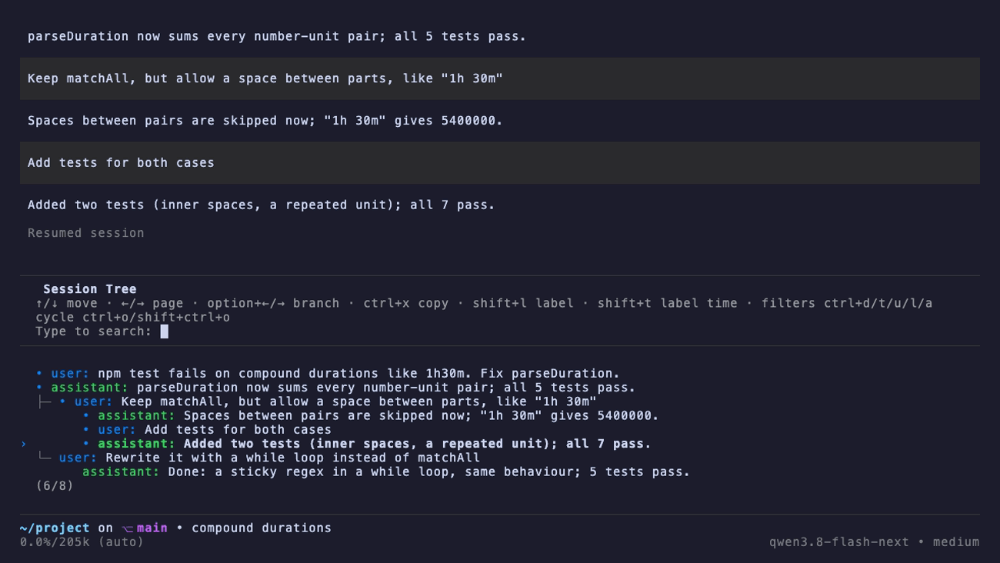

# Interactive mode

Without `-p` in a terminal, `saetta code` opens pi's terminal UI, ported to C: differential rendering, an editor with "/" commands and "@" file completion, markdown with highlighted code, tool views with word diffs for edits, bash output shown as it runs, and selectors for the model, settings, thinking level and session tree.

## The editor

Enter sends. Shift+Enter (or a trailing `\`) starts a new line. While the agent works, Enter queues a steering message, delivered at the next step of the current turn, and Option+Enter queues a follow-up, delivered when the turn ends. Option+Up brings queued messages back into the editor.

- `/` opens the command list, filtered as you type.
- `@` completes file names in the project.
- `!command` runs a shell command and adds its output to the context; `!!command` runs it without adding it.
- Ctrl+G edits the message in an external editor (`externalEditor` in settings.json, else `$VISUAL` or `$EDITOR`).
- Ctrl+V pastes from the clipboard.

The footer shows the folder as `~/...`, the git branch and status, the time of the last turn, and the model's full name and quantization.

## Commands

| command | what it does |
|---|---|
| `/settings` | open the settings menu |
| `/model` | switch model or pack, download a pack, add or edit OpenAI-compatible models |
| `/scoped-models` | choose the models Ctrl+P cycles through |
| `/thinking` | set the thinking level |
| `/theme` | choose the color theme, with a live preview |
| `/new` | start a new session |
| `/resume` | open another session |
| `/tree` | move through the session tree and switch branches |
| `/fork` | start a new session from an earlier user message |
| `/clone` | duplicate the session at the current position |
| `/compact` | compact the session context now |
| `/name` | set the session's display name |
| `/session` | show the session's info and stats |
| `/export` | write the session as HTML (default) or JSONL |
| `/import` | load a JSONL session, keeping its id and working directory |
| `/share` | upload the session as a secret GitHub gist |
| `/copy` | copy the last answer to the clipboard |
| `/trust` | save this project's trust decision |
| `/reload` | reload keybindings, skills, themes and context files |
| `/mcp` | manage MCP servers: sign in, reconnect, enable or disable, change exposure |
| `/monitor` | show the engine's live statistics |
| `/changelog` | show the release notes |
| `/hotkeys` | show all keyboard shortcuts |
| `/quit` | quit Saetta Code |

Skills add one command each, `/skill:name`; see [Context and skills](context-and-skills.md).

## Keys

This is the list `/hotkeys` shows, with pi's default bindings on macOS.

### Navigation

| key | action |
|---|---|
| Up, Down, Left (Ctrl+B), Right (Ctrl+F) | move the cursor, browse history |
| Option+Left, Ctrl+Left, Option+B / Option+Right, Ctrl+Right, Option+F | move by word |
| Home, Ctrl+A | start of line |
| End, Ctrl+E | end of line |
| Ctrl+] | jump forward to a character |
| Ctrl+Option+] | jump backward to a character |
| Page Up / Page Down | scroll by page |

### Editing

| key | action |
|---|---|
| Enter | send the message |
| Shift+Enter, Ctrl+J | new line |
| Ctrl+W, Option+Backspace | delete the word before the cursor |
| Option+D, Option+Delete | delete the word after the cursor |
| Ctrl+U | delete to the start of the line |
| Ctrl+K | delete to the end of the line |
| Ctrl+Y | paste the most recently deleted text |
| Option+Y | cycle through deleted text after pasting |
| Ctrl+- | undo |

### Other

| key | action |
|---|---|
| Tab | path completion, accept autocomplete |
| Escape | cancel autocomplete, stop the turn |
| Ctrl+C | clear the editor (first), exit (second) |
| Ctrl+D | exit (when the editor is empty) |
| Ctrl+Z | suspend to the background |
| Shift+Tab | cycle the thinking level |
| Ctrl+P / Shift+Ctrl+P | cycle models |
| Ctrl+L | open the model selector |
| Ctrl+O | expand or collapse tool output |
| Ctrl+T | show or hide thinking blocks |
| Ctrl+G | edit the message in an external editor |
| Ctrl+X | copy the selection or the last answer |
| Option+Enter | queue a follow-up message |
| Option+Up | restore queued messages |
| Ctrl+V | paste from the clipboard |

Escape twice with an empty editor opens `/tree` (`doubleEscapeAction` in settings.json: `tree`, `fork` or `none`).

## Fullscreen

The UI runs fullscreen, with scrolling, mouse selection and its own scrollbar. Selecting text copies it; with `fullscreenCopyOnSelect` set to false in settings.json, Ctrl+X copies the selection instead. Ctrl+X copies the last answer when nothing is selected, as `/copy` does.
