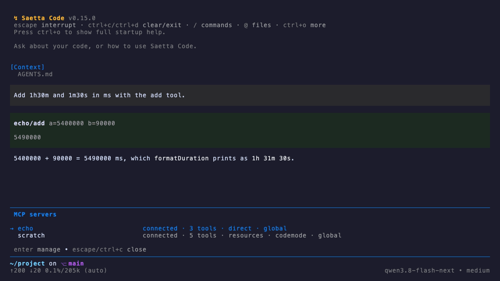

# MCP

Saetta Code connects to [Model Context Protocol](https://modelcontextprotocol.io) servers as pi does, from the same `mcp.json` files, over stdio or Streamable HTTP. Their tools are offered to the model as `mcp__server__tool`, along with tools to read the servers' resources (`list_mcp_resources`, `list_mcp_resource_templates`, `read_mcp_resource`).



## mcp.json

Servers come from two files, under a `mcpServers` key:

| file | scope |
|---|---|
| `mcp.json` in the agent folder (`~/.pi/agent/mcp.json`) | every project |
| `.pi/mcp.json` in the project | this project, only when it is trusted |

A server with `command` runs over stdio; one with `url` over Streamable HTTP:

```json
{
  "mcpServers": {
    "files": {
      "command": "npx",
      "args": ["-y", "@modelcontextprotocol/server-filesystem", "~/src"],
      "env": { "LOG_LEVEL": "warn" }
    },
    "tracker": {
      "url": "https://mcp.example.com/mcp",
      "headers": { "Authorization": "Bearer $TRACKER_TOKEN" },
      "timeout": 60
    }
  }
}
```

| field | applies to | meaning |
|---|---|---|
| `command`, `args`, `env`, `cwd` | stdio | the program to run, its arguments, extra environment, working folder |
| `url`, `headers` | HTTP | the server's Streamable HTTP endpoint (`http` or `https`) and request headers |
| `oauth` | HTTP | OAuth client settings (below) |
| `enabled` | both | `false` keeps the server configured but off |
| `timeout` | both | seconds to wait for a request |
| `exposure`, `toolExposure` | both | `hidden` keeps a server's tools (or the named ones) from the model |
| `description` | both | a note shown in `/mcp` |

Header values resolve `$VAR`, `${VAR}` and `!command` as API keys do (see [Models and providers](models-and-providers.md#api-keys)). The legacy SSE transport is not supported. A project `mcp.json` entry with only `enabled` or `exposure` overrides a global server of the same name for that project.

## /mcp

`/mcp` lists the servers with their state (connecting, connected, needs sign-in, failed) and tools. From it you can reconnect a server, enable or disable it, change its exposure, and sign in or out. The change is saved to the `mcp.json` the server came from, or as a project override.

```text
/mcp login tracker
/mcp logout tracker
/mcp reconnect files
```

`--no-mcp` starts the agent with no MCP servers and no MCP tools. MCP servers restart when the session switches to another folder.

## OAuth sign-in

An HTTP server without an `Authorization` header signs in with OAuth when it asks for it. The agent discovers the authorization server, registers a client (dynamic registration, or a client ID metadata document), opens the browser for the authorization code flow with PKCE, and receives the redirect on a loopback address. When the browser is on another machine, paste the redirect URL into the agent instead. Tokens are refreshed when they expire, and a server asking for more scope gets a new sign-in.

Sign-ins are stored in `mcp-auth.json` in the agent folder, in pi's format, so pi and Saetta Code share them.

The `oauth` object sets the client when a server needs it:

```json
{
  "mcpServers": {
    "tracker": {
      "url": "https://mcp.example.com/mcp",
      "oauth": {
        "clientId": "saetta-local",
        "clientSecret": "$TRACKER_CLIENT_SECRET",
        "scope": "read write",
        "callbackPort": 33418
      }
    }
  }
}
```

Its other keys are pi's: `clientRegistration` (`auto`, `dcr` or `cimd`), `clientName` and `callbackUrl`.
