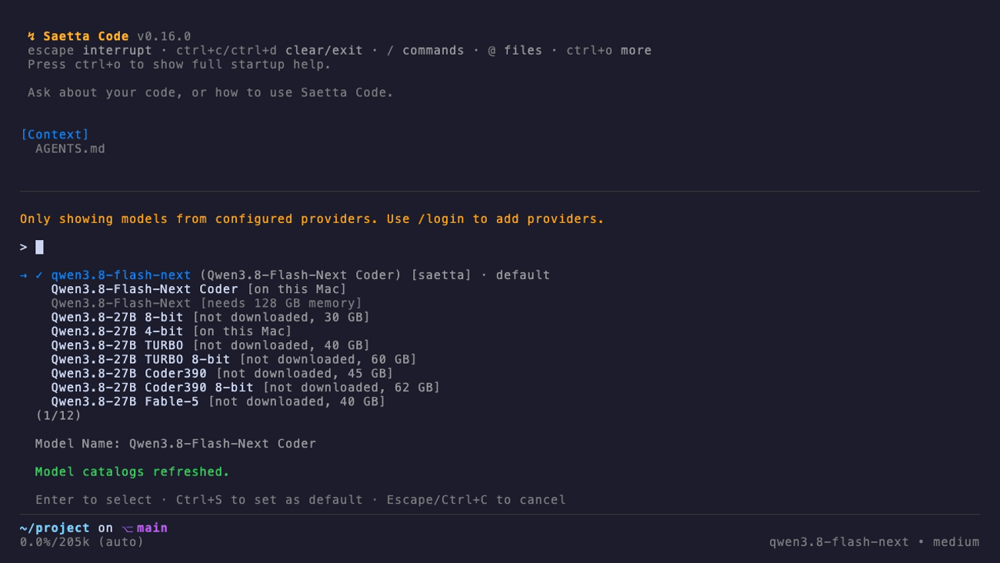

# Models and providers

Saetta Code talks to a model in one of three ways:

1. A Saetta pack loaded inside the agent's process (the default with `saetta start code`).
2. A running Saetta server on this Mac.
3. Any OpenAI-compatible chat completions server listed in `models.json`.



## /model

`/model` lists everything the agent can use: the packs downloaded on this Mac, the packs it can download (with their size and the free disk shown first; a pack too big for this Mac's memory is greyed out), a running Saetta server, and the models in `models.json`. Picking a pack switches to it in the running agent. From the same list you can add, edit or remove an OpenAI-compatible model.

`/model provider/id` switches without the list, and Ctrl+L opens it.

From the command line:

```sh
saetta code --pack coder                          # a pack, in this process
saetta code --pack ~/Models/my-pack --ctx 65536   # a pack folder, with a smaller context
saetta code --provider saetta --model qwen3.8-flash-next
saetta code --model myprovider/my-model:high       # a models.json entry, thinking high
```

A model given as `provider/id` can end in `:level` to set the thinking level. Without `--model`, the agent uses `defaultProvider` and `defaultModel` from settings.json, which `/model` updates when you switch.

## models.json

Providers are pi's `models.json` in the agent folder. Saetta Code uses providers whose `api` is `openai-completions`. This is the entry `saetta start` writes for the local server:

```json
{
  "providers": {
    "saetta": {
      "baseUrl": "http://127.0.0.1:8080/v1",
      "api": "openai-completions",
      "apiKey": "saetta",
      "compat": {
        "supportsDeveloperRole": false,
        "supportsStore": false,
        "supportsReasoningEffort": false,
        "maxTokensField": "max_tokens",
        "thinkingFormat": "qwen-chat-template"
      },
      "models": [{
        "id": "qwen3.8-flash-next",
        "name": "Qwen3.8-Flash-Next (saetta)",
        "reasoning": true,
        "input": ["text"],
        "contextWindow": 204800,
        "maxTokens": 32768,
        "cost": { "input": 0, "output": 0, "cacheRead": 0, "cacheWrite": 0 }
      }]
    }
  }
}
```

Another provider is added next to it with its own `baseUrl`, `apiKey` and `models`. `contextWindow` sets when compaction starts, `reasoning` whether thinking levels apply, and `compat` the request fields the server understands.

### API keys

`apiKey` (and header values) are resolved as pi resolves them:

| value | resolves to |
|---|---|
| `"sk-..."` | the text as written |
| `"$OPENROUTER_API_KEY"` or `"${OPENROUTER_API_KEY}"` | the environment variable |
| `"!security find-generic-password -ws openrouter"` | the trimmed output of the command, run with `/bin/sh` (10 s limit) |

`$$` and `$!` stand for a literal `$` and `!`.

## Scoped models

`/scoped-models` picks the models that Ctrl+P and Shift+Ctrl+P cycle through. The choice is saved as `enabledModels` in settings.json.

## Thinking levels

For a model with `reasoning`, `/thinking` and Shift+Tab choose a level:

| level | meaning |
|---|---|
| `off` | no reasoning |
| `minimal` | very brief reasoning (about 1K tokens) |
| `low` | light reasoning (about 2K tokens) |
| `medium` | moderate reasoning (about 8K tokens) |
| `high` | deep reasoning (about 16K tokens) |

`--thinking` also accepts `xhigh` and `max`. `defaultThinkingLevel` in settings.json sets the level a session starts with. Ctrl+T hides or shows the thinking blocks.

## The local server

With a Saetta server running (`saetta serve`, or one that `saetta start` started), `saetta start code` joins it instead of loading the model again, and `/model` lists its model. A server is needed for LoRA adapters:

```sh
saetta start code --pack 27b-8bit --lora qwen3.8-pi=27b-pi
```

See [LoRA adapters](lora.md) and [HTTP API](http-api.md).
