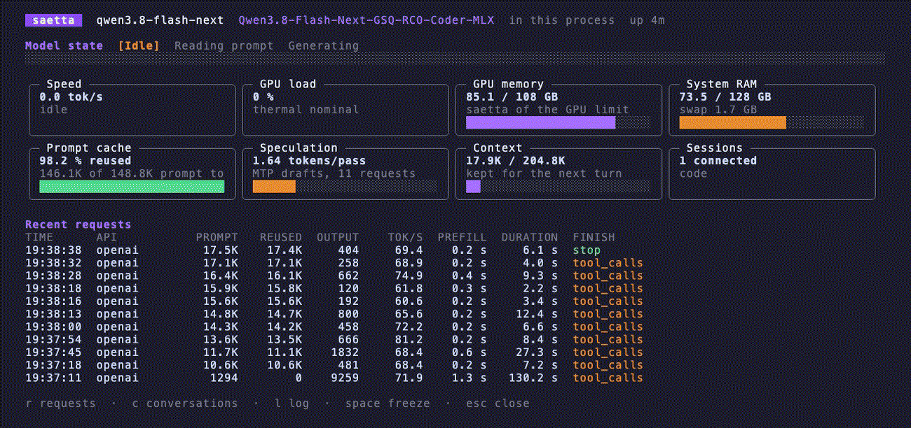

# /monitor

`/monitor` shows the engine's live statistics inside Saetta Code, over the whole screen and refreshed twice a second: model state, speed, GPU load, memory, prompt-cache reuse, speculation, sessions and recent requests. It is the same view as [`saetta monitor`](server.md), without leaving the agent.

| key | effect |
|---|---|
| `r` | recent requests |
| `c` | conversations |
| `l` | the server log |
| space | freeze or resume the view |
| Esc, `q`, Ctrl+C | close it |

The numbers come from where the model runs:

- With a pack loaded in the agent's process, from that engine.
- With the model on the Saetta server of this Mac, from the server (the snapshot `saetta monitor` reads).
- With any other provider there are no engine statistics, and the view says so.

pi has no such command; it is Saetta Code's own.
