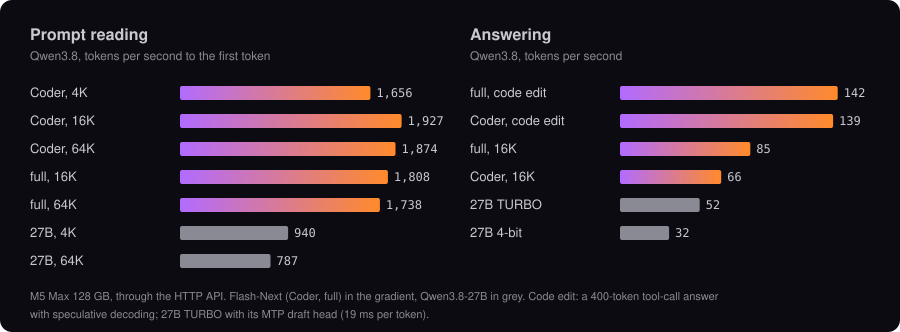
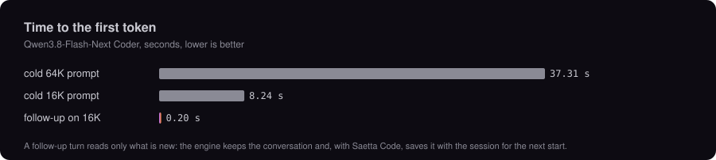
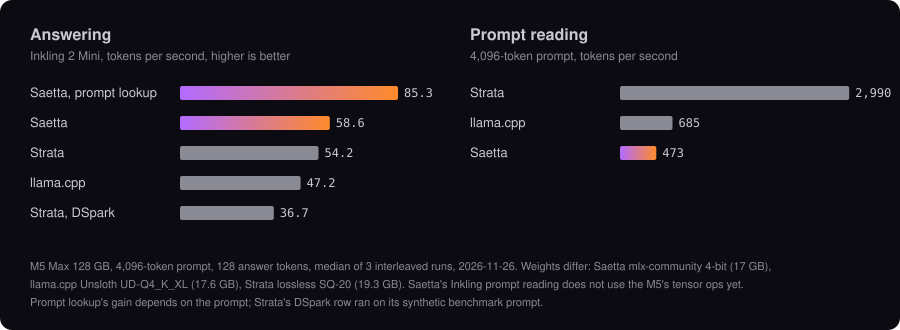
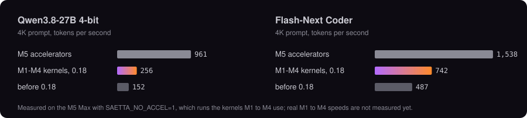

# Performance

Saetta is tuned and measured on an M5 Max with 128 GB. M1 to M4 have half-precision kernels of their own on their GPU cores; they are not measured on real hardware yet (reports welcome).

## Flash-Next on an M5 Max

A six-request coding-agent workload through the HTTP API, seconds (first token / total):

| request | prompt tokens | full | Coder |
|---|---:|---:|---:|
| cold 4K | 3,335 | 2.06 / 3.66 | 2.01 / 3.90 |
| cold 16K | 15,873 | 8.78 / 10.61 | 8.24 / 10.86 |
| cold 64K | 69,923 | 40.23 / 42.16 | 37.31 / 39.87 |
| turn 1 | 15,867 | 8.68 / 9.39 | 8.07 / 8.81 |
| turn 2 (reuses turn 1) | 15,951 | 0.20 / 0.87 | 0.20 / 0.79 |
| edit (tool call, 400 tokens out) | 18,243 | 10.09 / 12.91 | 9.37 / 12.25 |
| sum of totals | | 79.6 | 76.5 |

Prompts at 1,620 to 1,930 tokens/s; answers at 78 to 85 (full) and 66 to 75 (Coder) tokens/s, 142 and 139 tokens/s on the edit with speculation.

## Qwen3.8-27B

Prompts at 940 tokens/s (4K) to 787 (64K); answers at 31 ms/token on the 4-bit pack, 19 ms/token on `27b-turbo` with its MTP head (short prompts; 25 ms/token at 16K).

## What makes follow-up turns fast

A coding agent sends the whole conversation on every turn. Saetta keeps each conversation's state and reads only what is new, so turn 2 above, on a 16K conversation, answers in 0.2 s. Up to 4 conversations are kept (`SAETTA_CONVERSATIONS`), so several agent sessions keep their fast turns.

## Speculative decoding

Packs with an MTP head (Flash-Next, and the 27B fine-tunes marked "with MTP" on [Choosing a model](choosing-a-model.md)) draft tokens with it; the server also drafts from text already in the prompt. Every drafted token is checked by the model. Greedy requests (`temperature` 0) pick the model's top token as without speculation, but the check runs the drafted tokens as one batch, whose arithmetic rounds slightly differently, so at a near tie a long answer or a later request can take the other token; and sampled ones use speculative sampling, which keeps the same output distribution. `SAETTA_SPEC=0` and `SAETTA_MTP=0` turn it off.

## Watching it

`saetta monitor` (or `/monitor` in Saetta Code) shows speed, prompt-cache reuse and speculation live. See [monitor, status, stop](server.md).

## Inkling 2 Mini against llama.cpp and Strata

The same 4,096-token prompt and 128 answer tokens, median of 3 interleaved runs (2026-11-27). Saetta answers at 58.7 tokens/s (71.5 with its default prompt lookup), Strata at 54.2 (36.7 with DSpark, on its synthetic benchmark prompt), llama.cpp at 47.3. Strata reads prompts at 2,963 tokens/s, Saetta at 2,396, llama.cpp at 685. Since 0.22 Saetta runs Inkling's prompt on the M5's tensor ops (half-precision activations, f32 sums; checked against the reference by KL), up from 473 tokens/s; on M1 to M4 and with `SAETTA_NO_ACCEL=1` it keeps the f32 kernels. Prompt lookup's gain depends on the answer: on this synthetic prompt 0.21 fell into a repetition loop that lookup sped up (85.3 tokens/s). Each engine uses its own weights: Saetta the mlx-community 4-bit pack (17 GB), llama.cpp Unsloth's UD-Q4_K_XL (17.6 GB), Strata its lossless SQ-20 (19.3 GB).

## M1 to M4

`SAETTA_NO_ACCEL=1` makes the M5 Max run the kernels M1 to M4 use. On it, a 4K prompt reads at 256 tokens/s on the 27B 4-bit and 742 on the Coder (before 0.18: 152 and 487), against 961 and 1,538 with the M5's neural accelerators.
