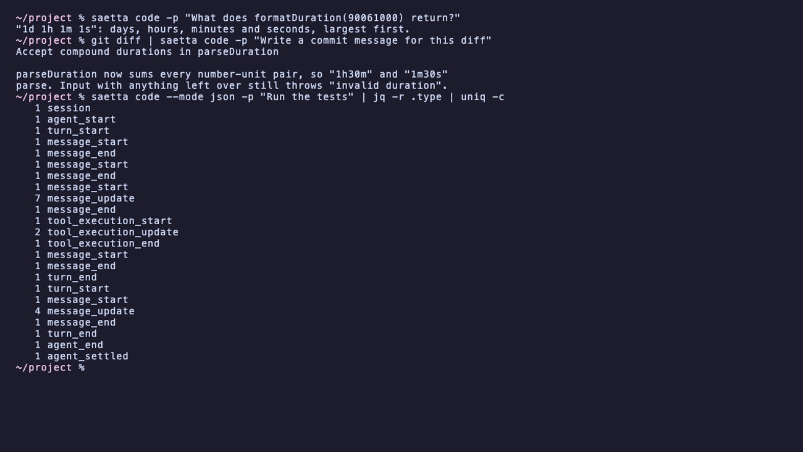

# Print, JSON and RPC modes

Besides the terminal UI, Saetta Code has pi's three non-interactive modes, for scripts, CI and programs that drive the agent. All three use the same tools, context files, skills and session files as the interactive mode.



## Print mode

`-p` (`--print`) answers the prompt, prints the final text and exits:

```sh
saetta code -p "fix the failing test"
saetta code -p --pack 27b-turbo "summarize what src/server.c does"
git log -20 --oneline | saetta code -p "write release notes from these commits"
```

Piped input is joined to the prompt, and makes the run a print run even without `-p`. The session is saved as usual (`--no-session` skips it), so `saetta code -c` can continue it in the terminal UI.

A run that a crash or a kill cut off is resumed with `--recover` (in this folder, or the session given with `--session`): read-only tool calls that were running run again, the others are reported to the model as interrupted, and the run goes on. See [Interrupted runs](sessions.md#interrupted-runs).

In a project that is not yet trusted there is no prompt to ask in, so project resources stay off; pass `--approve` to trust it for the run. See [Context and skills](context-and-skills.md#project-trust).

## JSON mode

`--mode json` prints pi's event stream instead of the text, one JSON object per line: the session header first, then the agent's events as they happen.

```sh
saetta code --mode json -p "list the files in src" > events.jsonl
```

| event | when |
|---|---|
| `session` | first line: the session header (format version, id, timestamp, working directory) |
| `agent_start`, `agent_end` | the run starts and ends |
| `turn_start`, `turn_end` | each model call with its tool results |
| `message_start`, `message_update`, `message_end` | a message is created, streams, is complete |
| `tool_execution_start`, `tool_execution_update`, `tool_execution_end` | a tool runs, with partial and final output |
| `compaction_start`, `compaction_end` | an automatic compaction |
| `auto_retry_start`, `auto_retry_end` | a failed request is retried |
| `queue_update` | queued steering or follow-up messages changed |

Retries follow `retry` in settings.json (pi's keys and defaults: `enabled` true, `maxRetries` 3, `baseDelayMs` 2000, `maxAgentDelayMs` 60000).

## RPC mode

`--mode rpc` is pi's rpc protocol: JSON commands on stdin, one per line, and on stdout a response to each command plus the session's events (the same events as JSON mode). It keeps running until stdin closes, so one process serves many prompts.

```sh
saetta code --mode rpc
```

```json
{"id": "1", "type": "prompt", "message": "add a --verbose flag to the CLI"}
{"id": "2", "type": "get_state"}
{"id": "3", "type": "abort"}
```

Each response carries the command's `id`, `"type": "response"`, the command's name in `command`, and `success` with `data`, or `"success": false` with an `error`:

```json
{"id":"2","type":"response","command":"get_state","success":true,"data":{...}}
```

| command | what it does |
|---|---|
| `prompt` | send a message (while streaming, `streamingBehavior` says whether it steers or follows up) |
| `steer`, `follow_up` | queue a steering or follow-up message |
| `abort`, `clear_queue` | stop the turn, drop queued messages |
| `get_state`, `get_messages`, `get_entries`, `get_tree`, `get_session_stats` | read the session |
| `get_last_assistant_text`, `get_fork_messages`, `get_commands` | the last answer, the messages a fork can start from, the commands (MCP and skills) |
| `new_session`, `switch_session`, `fork`, `clone`, `set_session_name` | manage sessions |
| `compact`, `set_auto_compaction` | compact now, turn automatic compaction on or off |
| `set_model`, `cycle_model`, `get_available_models` | choose the model |
| `set_thinking_level`, `cycle_thinking_level`, `get_available_thinking_levels` | choose the thinking level |
| `set_steering_mode`, `set_follow_up_mode` | `one-at-a-time` or `all` |
| `set_auto_retry`, `abort_retry` | retries of failed requests |
| `bash`, `abort_bash` | run a shell command into the context, stop it |
| `export_html` | write the session as HTML |

Saetta Code's rpc mode is compared with pi's on 12 recorded scenarios, driven by pi's own rpc client, so a program written against pi's rpc mode drives Saetta Code too. Extension UI requests never occur, since Saetta Code runs no extensions, and image input is not supported.
