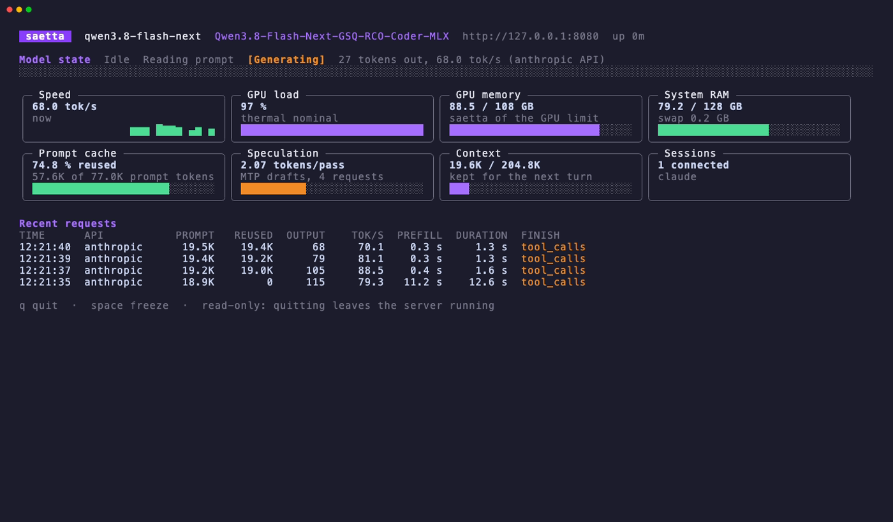

# monitor, status, stop

One Saetta server runs on a Mac at a time. These commands look at it and stop it, whichever way it was started (`saetta serve`, or `saetta start` for an agent).

```sh
saetta monitor | status | stop           # live view, state, stop
```

## saetta monitor

`saetta monitor` shows the server live, full screen: model state, speed, GPU load, memory, prompt cache, speculation, sessions and recent requests.



| key | effect |
|---|---|
| `r` | recent requests |
| `c` | conversations |
| `l` | the server log |
| space | freeze or resume the view |
| `q`, Esc, Ctrl+C | quit |

`saetta monitor --once` prints one frame and exits, with `--conversations` or `--log` for those panels. Inside Saetta Code the same view is [/monitor](monitor.md).

## saetta status

```text
$ saetta status
saetta: server running, pid <pid>, http://127.0.0.1:8080 (auto)
  model    qwen3.8-flash-next (<pack>), context <n> tokens, up <n> min
  state    <state>, <n> requests, <n> conversation(s) kept
  GPU      <n> of <n> GB
  sessions <n>: claude (pid <pid>), pi (pid <pid>)
```

`auto` means the server was started by `saetta start` and stops with its last session; `manual`, by `saetta serve`. A server started with `saetta start --keep` stays up with no session. With no server, `saetta status` prints `saetta: no server is running`.

## saetta stop

`saetta stop` stops the running server (waiting up to 30 s for it to finish).

## Logs

A server started by `saetta start` logs to `~/Library/Logs/saetta/serve-<port>.log`; `saetta serve` logs to the terminal. Each request prints a `request:` line with prompt tokens, reused tokens, prefill and decode times. Saetta Code's own log is `~/.saetta/code.log`.
