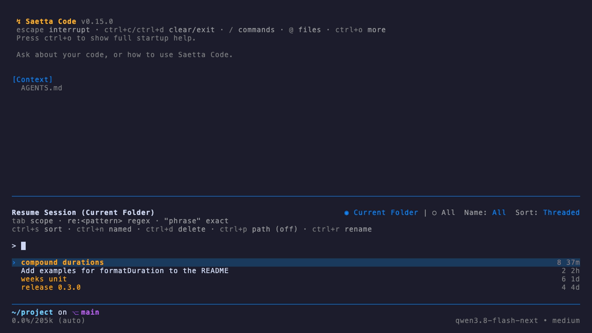
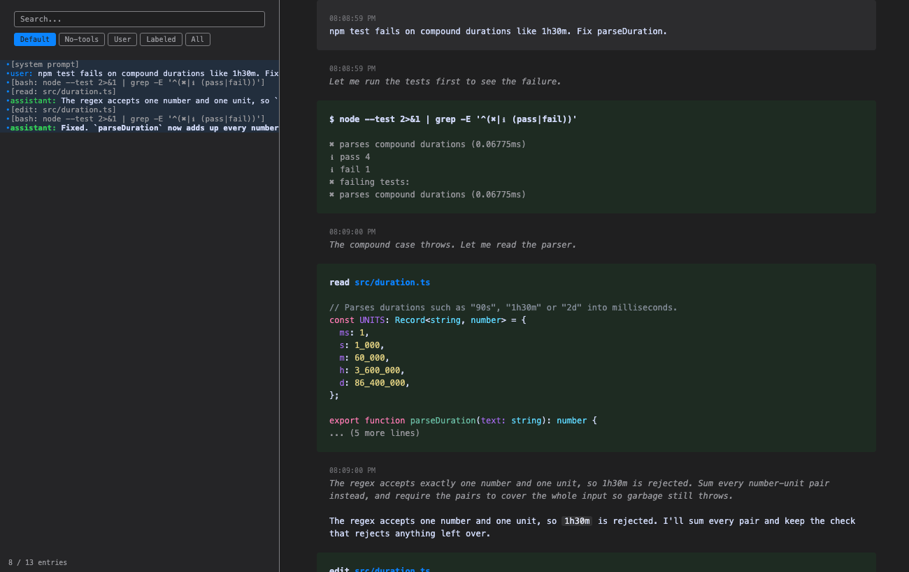

# Sessions

Every conversation is a session: a JSONL file of entries (messages, tool results, model changes, compactions) that form a tree. Saetta Code writes them in pi's format and folder, so pi and Saetta Code continue each other's sessions, compacted ones included.

Sessions live in the agent folder, one subfolder per working directory:

```text
~/.pi/agent/sessions/--Users-me-src-my-project--/<timestamp>_<id>.jsonl
```

(`~/.saetta/pi/sessions/...` when the agent was started with `saetta start code`; see [Saetta Code](saetta-code.md#the-configuration-folder).)

## Continue and resume

```sh
saetta code -c                            # the most recent session in this folder
saetta code --session path/to/file.jsonl  # a given session file
saetta code --no-session                  # do not save this one
```

In the agent, `/resume` opens a picker of earlier sessions, searchable by their messages and names, and `/new` starts a fresh one.

With the model in the agent's process, the engine's state of the conversation (its KV cache and recurrent state) is saved to `~/.saetta/state` in the background at the end of each turn. A session resumed later, or forked from an earlier message with `/fork`, continues from that state instead of reading its whole history again: only the new message is read. A session another terminal joins (`saetta start code` beside a running one) resumes from saved states but does not save its own. The folder keeps up to 20 GB in all and nothing unused for 7 days; states are tied to the pack, the engine build and this Mac, and checked at every read. `SAETTA_STATE=0` turns it off. Not yet for Inkling 2 Mini or with a LoRA adapter.

While a conversation is in memory, the engine also keeps checkpoints (message starts at least 1024 tokens apart, plus each request's start; up to 16 for the conversation in use, the recent ones dense and the older ones spaced out, and 3 while another conversation runs: its most recent, its last request's start and its oldest), so a retried turn, an edited message or a `/fork` restarts at the nearest checkpoint instead of reading the history again. In Saetta Code it restarts in the same conversation; over the HTTP API (`saetta serve`, Claude Code, pi, opencode) the request goes to another conversation, which starts from a copy of that history, unless the conversation limit is reached. For Qwen3.8-Flash-Next and Qwen3.8-27B. Each checkpoint takes 118 MB (Flash-Next) or 157 MB (27B) of memory, counted when the context limit is fitted to this Mac; when memory runs short, the checkpoints of conversations not in use go first. A saved state holds the conversation's last two checkpoints.

While a command runs (the bash tool), Saetta Code with the model in its process has the engine read the output printed so far into the conversation, after the message that called the tool, in chunks of up to 2048 tokens. When the command ends, the request that carries its result finds most of it already read and reads only the rest, so the answer starts sooner (results of earlier calls in the same message are read while the later ones run). The request still decides: when its tokens differ from what was read (a command whose output got too long is cut to its tail), it reads again from the last checkpoint before the difference; the answer is the same, token for token, as without reading ahead. A request from another agent or session waits at most one chunk. For Qwen3.8-Flash-Next and Qwen3.8-27B, not yet for Inkling 2 Mini or over the HTTP API; `SAETTA_AHEAD=0` turns it off.

After a read, an edit or a write, Saetta Code with the model in its process also hands the file's content, as it now is on disk, to the engine's prompt lookup for that session. An edit's `oldText` and `newText` are written inside the tool call as JSON strings, where the file's lines are joined by `\n` escapes; the file's own text in a read's result does not match them past a line, so drafting from the conversation alone breaks at every line of a copied block. With the file fed, the engine drafts whole runs of it. Every drafted token is checked by the model before it is kept. The engine keeps a file's first 65,536 tokens, 131,072 per session and the files of 4 sessions; when the agent moves to another session (`/new`, `/resume`, a `/fork` to a new file), the previous session's files are dropped. For Qwen3.8-Flash-Next and Qwen3.8-27B, not yet for Inkling 2 Mini or over the HTTP API; `SAETTA_FEED=0` turns it off.



## Interrupted runs

A run that stops in the middle (a crash, a kill, a closed terminal, a reboot) can be resumed. While the agent works, Saetta Code keeps a journal of the run beside the session file (`<session>.jsonl.run`, which pi does not list): the prompt, each message before it reaches the session file, each tool call before it starts and its result when it ends, the output a running command printed (once a second), and the messages queued meanwhile. The journal is removed when the run ends, so one exists only for a run that is going on or was cut off. The session file itself stays pi's.

At the next start in that folder (with or without `-c`), Saetta Code offers the interrupted run:

```text
The last run in this folder was interrupted 4 minutes ago (session "fix the parser").
It was running: bash  npm test
> Resume the run
  Open the session without resuming
  Discard the run
```

- **Resume the run**: messages the session file lost are written back, tool calls that finished keep their result, and the run goes on from where it stopped. read, grep, find and ls calls that were running run again. A bash, write, edit, MCP or subagent call that was running is never run again on its own: Saetta Code asks ("Run it again?", with a hint for write and edit saying whether the change looks applied). The default reports it to the model as interrupted, with the output it printed, and the model decides what to do. Messages queued before the crash are sent with the resumed run.
- **Open the session without resuming**: the running calls are reported as interrupted in the session, nothing runs and nothing is sent.
- **Discard the run**: the journal is removed and the session stays as pi leaves it.
- Escape leaves the choice for the next start.

A run interrupted 3 times in a row without progress is not resumed again: its open calls are reported as interrupted. A run whose session was continued meanwhile (by pi or another Saetta Code) is not offered. Without a terminal, `saetta code --recover` resumes the run (calls that may have had effects are reported as interrupted), in print and JSON mode.

## The session tree

A session is a tree, not a list: going back to an earlier message and continuing from there adds a branch, and the old branch stays in the file.

- `/tree` shows the tree and moves to any entry. Its filter (default, no tools, user messages only, labeled only, all) starts from `treeFilterMode` in settings.json. Escape twice in an empty editor opens it too.
- `/fork` picks an earlier user message and starts a new session file from it, with that message in the editor.
- `/clone` copies the session at the current position into a new session file.
- `/name` sets the display name shown in `/resume`; `/session` shows the file, the message and token counts and the cost.

## Compaction

When the context gets close to the model's window, the agent compacts it: older messages are summarized by the model into one compaction entry, and the recent ones are kept as they are. The full history stays in the session file.

`/compact` compacts now. Text after it guides the summary:

```text
/compact keep the details of the parser bug and the failing test names
```

Automatic compaction is on by default and is toggled in `/settings` (Auto-compact). Its settings in settings.json are pi's:

```json
{
  "compaction": {
    "enabled": true,
    "reserveTokens": 16384,
    "keepRecentTokens": 20000
  }
}
```

`reserveTokens` is the room kept free for the answer, `keepRecentTokens` how much recent context stays uncompacted. `compaction.modelOverrides`, keyed by `provider/model`, sets either value for one model.

## Export, import and share

```text
/export                        pi-session-<id>.html in the current folder
/export notes/session.html     an HTML page at that path
/export session.jsonl          the session file itself
/import ~/Downloads/session.jsonl
/share
/copy
```

The HTML export is pi's page: the conversation with its tool calls, thinking blocks and diffs, readable in any browser. `/import` loads a JSONL session and keeps its id and working directory. `/share` uploads the HTML export as a secret GitHub gist and prints its link; it uses the GitHub CLI (`gh`), signed in. `/copy` copies the last answer to the clipboard.


